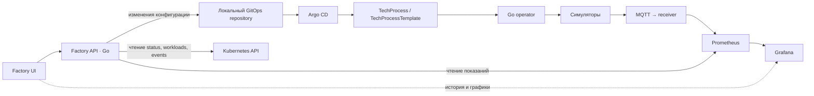

# План диспетчерской панели Factory UI

Дата исходного аудита: 2026-11-08. U1 реализован: read-only Factory API, обзор участка, карточки, Kubernetes/Prometheus adapters, контейнер, RBAC и Make targets. Запуск описан в [runbook](../runbooks/factory-ui.md), решение — в [ADR 0008](../adr/0008-factory-overview.md). U2–U5 остаются планом. Таблица исходного аудита ниже описывает состояние до начала U1.

## Цель и границы

Сделать локальную веб-панель, из которой можно увидеть состояние участка, выбрать профиль изделия A/B, изменить учебные настройки оборудования и проследить применение новой ревизии. Первый полезный результат — обзор работающего стенда; первый законченный сценарий управления — A → B → A через GitOps.

В этом плане «переключение» означает смену профиля техпроцесса. Редактор позволяет настраивать отдельное устройство, но изменение применяется через ревизию всего процесса. Включение/выключение устройств, приостановка линии и замена физического оборудования требуют отдельной модели жизненного цикла и не должны изображаться уже работающими возможностями.

Практическая часть остаётся симуляционной: шесть рабочих мест, восемь устройств, одна демонстрационная линия `line-one`. Аппаратные драйверы, реальная калибровка, управление движением механизмов и производственная БД в объём UI не входят. Критический контур и доступ к панели работают локально; облачный сервис не нужен.

Основания: [требования](../../Диплом.md), [общий план](../../План.md), [модель цеха](../architecture/assembly-workshop.md), [ADR 0002](../adr/0002-resource-ownership.md), [ADR 0005](../adr/0005-equipment-simulation.md), [ADR 0006](../adr/0006-simulated-telemetry.md), [ADR 0007](../adr/0007-monitoring-stack.md). Уточнения в плане и ADR имеют значение: ранняя постановка с прямой записью API в Kubernetes и аппаратным Edge Agent не описывает принятый MVP.

## Что уже реализовано

| Подсистема | Состояние по коду | Что это даёт UI / чего не хватает |
|---|---|---|
| `TechProcess`, `TechProcessTemplate` | API `production.factory.local/v1alpha1`, selectors, параметры, timeout, Conditions | Можно читать желаемый профиль и ход применения; пользовательского API нет |
| Оператор | Создаёт Deployment/DaemonSet, immutable ConfigMap, owner references; рассчитывает ревизию; проверяет готовность этой ревизии | Основа экрана прогресса; обновления рабочих мест пока не упорядочены |
| Статус процесса | `observedGeneration`, версия/UID шаблона, `components`, счётчики workloads, время первого Ready | Можно отличать старый status от актуального; `appliedRevision` сам по себе не доказывает готовность |
| Каталог | Восемь стабильных ID, шесть логических рабочих мест, capability каждого устройства | Готовая основа карточек; внешнего редактируемого инвентаря нет |
| Рецепты | A/B встроены в `equipment.Profile`; продукт выбирается аргументом `--product` | Можно выбирать существующие профили; произвольные значения из формы пока применить нельзя |
| Параметры | `spec.parameters` входит в hash и монтируется в `/etc/factory/parameters`; задан `FACTORY_PARAMETERS_DIR` | Доставка уже есть, но симулятор её не читает; `parameters.product` сейчас описательный |
| HTTP симуляторов | Status, операции, mode, setup, calibrate | Можно сделать отдельный экран экспериментов; эти методы не меняют рецепт |
| Телеметрия | Симуляторы → MQTT → отдельный receiver → Prometheus | Наблюдаемое состояние и показания уже доступны; публичного JSON API оборудования у receiver нет |
| Grafana | Три provisioned dashboard, filters, alerts, учёт свежести | Исторические графики готовы, их можно открывать из карточек |
| Стенд и проверки | Kind, Make targets, CI, unit/envtest, код MQTT/monitoring/E2E проверок | Есть основа воспроизводимой установки; полный Kind E2E требует отдельной проверки окружения |
| Factory API / UI / GitOps | Исходников API/UI и развёртывания Argo CD в репозитории нет | Это новый вертикальный сценарий, а не подключение форм к готовому backend |

Опорные файлы: [API](../../api/v1alpha1/techprocess_types.go), [контроллер](../../internal/controller/techprocess_controller.go), [генератор workloads](../../internal/workload/builder.go), [каталог и рецепты](../../internal/equipment/catalog.go), [HTTP симулятора](../../internal/simulator/server.go), [его запуск](../../cmd/equipment-simulator/main.go), [правила мониторинга](../../config/monitoring/rules.yaml).

Дополнительные ограничения, влияющие на интерфейс:

- `status.workstations` объявлен, но контроллер его не заполняет. Его поля ориентированы на узлы, а логические рабочие места берутся из каталога; для UI нельзя считать эти сущности одинаковыми.
- Общая ревизия входит в pod template каждого компонента. Даже изменение настройки одного устройства сейчас обновит все восемь Deployment. Это необходимо показать до применения.
- У контроллера есть RBAC marker для finalizers, но обработчика безопасного shutdown/finalizer нет. Кнопку безопасного останова нельзя обосновать наличием этого marker.
- Нет `spec.suspend`, а replicas компонента ограничены снизу единицей. Режим `fault` не является командой «остановить линию».
- Отдельных Service для HTTP симуляторов сейчас нет; runbook использует `port-forward deployment/...`.
- Встроенные шаблоны A/B содержат `:dev`. Для воспроизводимого GitOps-профиля нужны уникальные неизменяемые теги/дижесты и доступные в Kind образы.

## Предлагаемая архитектура



Добавить один бинарник `cmd/factory-api` в существующий Go-модуль. Он обслуживает HTML, статические файлы и версионированный JSON API. Для первого UI достаточно `net/http`, `html/template`, CSS и небольших JavaScript-модулей с `fetch`; страницы и assets включаются через `go:embed`. Это сохраняет одну сборку и позволяет обойтись без дополнительного frontend toolchain. Стандартная библиотека поддерживает [HTML-шаблоны с контекстным экранированием](https://pkg.go.dev/html/template) и [встраивание файлов](https://pkg.go.dev/embed).

Выбор стека — рекомендация для данного масштаба. Если позже появятся сложный редактор маршрутов или большой набор интерактивных форм, тот же JSON API позволит подключить отдельный frontend.

Factory API читает Kubernetes, но изменение рабочего профиля записывает только в Git. Argo CD управляет CR, оператор — дочерними workloads и ConfigMap. Не добавлять второй режим записи CR из UI и не передавать команды настройки через MQTT.

На первом этапе браузер обновляет состояние раз в 3 секунды, не допуская перекрывающихся запросов. Backend ограничивает время обращений к источникам и возвращает доступную часть результата, если другой источник недоступен. SSE можно добавить после измерений, если polling окажется недостаточным.

## Экраны и поведение

| Экран | Содержимое | Действия |
|---|---|---|
| Обзор линии | Профиль, Ready/Progressing/Degraded/Unknown, готовые компоненты, схема шести рабочих мест, восемь устройств | Открыть устройство, перейти к смене профиля |
| Карточка устройства | Модель, рабочее место, текущий pod/node, желаемый и наблюдаемый рецепт, workload readiness, свежесть, исправность/подготовка/калибровка, характерные показания | Настроить рецепт, открыть Grafana с фильтрами |
| Переналадка | Профиль A/B, различия параметров, затрагиваемые устройства, предупреждение о перезапуске компонентов | Проверить изменения, применить |
| Изменения | Git commit, выбранный профиль, автор/время, состояние доставки, текущий прогресс и ошибки | Посмотреть diff, восстановить выбранную сохранённую конфигурацию новым коммитом |
| Эксперименты | Явная отметка «Симуляция», выбранное устройство и его текущий экземпляр | Вызвать fault/normal/uncalibrated/unprepared/slow, setup, calibrate, одну операцию |

Схема рабочих мест отображает технологический маршрут и состояния. Она не изображает движение плат, которого нет в модели. Три прибора программирования/испытаний находятся внутри одной карточки рабочего места, с отдельными состояниями.

В обычном потоке пользователь выбирает изделие, видит изменения в понятных единицах и наблюдает результат. YAML, Git SHA и подробности Kubernetes доступны в диагностике; их не нужно вводить вручную. Ошибки и состояния обозначаются текстом и значком, а не только цветом. Формы должны сохранять черновик при обновлении карточек и работать с клавиатуры.

### Источники состояния

| Данные | Источник и правило |
|---|---|
| Требуемый профиль/настройки | Git; API отдельно показывает, дошла ли эта версия до кластера |
| Текущий spec и ход rollout | Kubernetes CR, Deployment/DaemonSet; status принимается только для текущих generation и UID/generation шаблона |
| Состав рабочих мест | `equipment.Catalog`, компоненты выбранного шаблона; node name — отдельный атрибут размещения |
| Исправность, подготовка, калибровка, показания | Prometheus, при доступном источнике и свежем снимке |
| Наблюдаемые product/recipe/revision | Метрики `factory_equipment_info`; при отличии от целевой ревизии явно показывать предыдущую конфигурацию |
| Длительные графики | Существующие dashboard Grafana |
| История желаемых изменений | Git commits; это не полный журнал выполнения каждой переналадки |

Нужны разные индикаторы «готовность процесса» и «доступность телеметрии». Потеря MQTT/Prometheus даёт Unknown для наблюдений, но не переводит исправный процесс в Degraded и не меняет CR. Старая телеметрия не подтверждает применение нового рецепта. При ошибке Kubernetes нельзя бесконечно показывать последнее Ready как текущее.

Backend обращается к [HTTP API Prometheus](https://prometheus.io/docs/prometheus/latest/querying/api/) с фиксированными запросами и проверенными label values. В браузер не выдаются credentials и произвольный PromQL proxy. Для оперативных карточек учитывать `up`, свежесть снимка, timestamp источника и возраст выборки; не полагаться только на наличие серии в lookback-окне. Recording rules уже полезны для Grafana, но добавляют свой интервал вычисления.

## Этапы реализации

### U1. Обзор работающего участка

Реализован. Unit/race, envtest и проверки интерфейса доступны в репозитории; код Kind E2E расширен проверками UI. Полный запуск изолированного Kind E2E пока ограничен ошибкой подготовки узла окружения, а не объявлен успешно пройденным.

Добавить Factory API, модель представления участка и первый UI с обзором/карточками. Использовать реальные CR и Prometheus; тестовые ответы нужны только в тестах. Адаптеры Kubernetes и Prometheus отделить от чистой сборки модели состояния. Показывать недоступные источники независимо.

Добавить контейнер, Service, namespace-scoped read RBAC и локальный port-forward. Для первого профиля API работает внутри Kind, поэтому из браузера нужен только один адрес. Links Grafana используют настраиваемый внешний адрес и существующий `make grafana-open`.

Критерий: видны шесть мест и восемь устройств, включая ещё не приславшие снимок. При смене A/B существующим development-сценарием панель показывает прогресс новой ревизии. При отключении мониторинга состояние становится Unknown, а данные о workloads остаются доступны. Формы управления до появления write path недоступны.

### U2. GitOps и переключение профиля из UI

Подготовить отдельный desired-state repository, доступный локальным Factory API и Argo CD. Стартовый профиль должен включать воспроизводимый локальный Git remote и bootstrap; выбор готового Git-сервера и закреплённой версии записать в ADR. Существующий внешний GitLab может быть альтернативным подключением, но не обязательной зависимостью стенда.

В Git хранить `TechProcess` и версионированные `TechProcessTemplate`; дочерние Deployment/DaemonSet/ConfigMap туда не копировать. Каталожные версии считать неизменяемыми. Отдельно поставить Argo CD и описать Application/AppProject, область namespace, права и порядок bootstrap. Контролируемый GitOps-профиль не должен одновременно обновляться через `dev-demo`/`kubectl patch`.

Реализовать preview diff и применение A/B одним коммитом с изменением `templateRef` и согласованных параметров. Проверять expected branch HEAD, актуальность preview и разрешённые пути/поля. Повтор запроса с тем же request ID не создаёт новый коммит; конфликт двух пользователей возвращает 409 с предложением перечитать состояние. Не использовать force push. Для первой версии достаточно одного экземпляра API и сериализации writes; защита на Git HEAD нужна также от внешних писателей.

Git-адаптер может использовать системный `git` через `os/exec` без shell; путь репозитория, remote, branch и identity задаются администратором. Рабочая копия изолирована от исходников проекта. Для тестов достаточно временного bare remote. Credentials хранятся на сервере, Argo получает доступ на чтение. Коммит записывает автора запроса и request ID; HTTP timeout после push проверяется по remote перед повтором.

После применения API возвращает 202 и ссылку на изменение. UI различает стадии: `PendingSync` → `Progressing` → `Ready`, а также `Degraded`, `Superseded` и `Unknown`. Commit SHA, process revision hash и recipe ID — разные идентификаторы. Сравнение ведётся с конфигурацией конкретного коммита, а не просто с любым Ready в кластере. При новом desired state старое незавершённое изменение становится Superseded. Состояние текущего изменения восстанавливается из Git и кластера после перезапуска API; полноту прошлых результатов rollout без отдельного журнала не обещать.

Argo `Synced` означает доставку манифестов, а итоговую готовность подтверждает актуальный `TechProcess.status`. Можно добавить консервативный custom health check CR; его нельзя считать способным самостоятельно сверить другой объект шаблона. Основная проверка UI читает оба CR. Такой механизм расширения предусмотрен [Argo CD resource health](https://argo-cd.readthedocs.io/en/stable/operator-manual/health/).

Для быстрого обнаружения коммита настроить Git webhook либо явный интервал reconciliation и измерить задержку. Не рассчитывать, что авто-sync по умолчанию мгновенный. Ручное восстановление конфигурации создаёт новый Git commit согласно ADR 0002; встроенный Argo rollback не использовать как бизнес-операцию. Это также согласуется с [ограничениями automated sync Argo CD](https://argo-cd.readthedocs.io/en/stable/user-guide/auto_sync/).

Критерий: A → B → A выполняется из браузера; каждый переход виден в Git и заканчивается Ready для ожидаемой ревизии. Конкурирующее изменение не теряется. При недоступном Git запрос не выдаётся за принятый; при недоступном Argo коммит остаётся ожидающим. Workloads продолжают работать без Factory API и Git-сервера.

### U3. Настройки оборудования без пересборки образа

Добавить чистый пакет конфигурации рецептов, общий для API, проверки GitOps-манифестов и симулятора. Предлагаемый транспорт — версионированный JSON в одном ключе существующей `spec.parameters`, например `equipment-config.json`. На диске он уже будет доступен через immutable ConfigMap. Новый CRD для этого этапа не требуется.

Документ содержит `schemaVersion`, продукт и параметры по equipment ID. При отсутствии внешнего документа сохраняются встроенные A/B fixtures; при явно заданном невалидном документе запуск завершается ошибкой, без незаметного возврата к defaults. API формирует итоговую конфигурацию детерминированно, проверяет соответствие продукту выбранного шаблона и хранит значения так, чтобы перестановка ключей не создавала лишнюю ревизию.

| Устройство | Первые редактируемые поля учебного рецепта |
|---|---|
| Принтер пасты | Идентификатор трафарета |
| Установщик SMD | Программа и число компонентов |
| Печь | Программа и пиковая температура |
| AOI | Программа проверки |
| Ручная пайка | Инструкция, температура жала и число соединений |
| Программатор | Идентификаторы прошивки и оснастки |
| Блок питания | Напряжение и ограничение тока |
| Мультиметр | Номинальное напряжение и нижняя/верхняя границы допуска |

Поля формы, единицы, типы и проверки брать из одной схемы. Не разрешать пользователю менять equipment identity/capability через рецепт. Валидация отклоняет неизвестные поля/устройства, неверные типы, недопустимые значения и противоречивые границы; ограничения учебной модели не выдаются за паспортные характеристики. Восемь устройств и общий продукт должны оставаться согласованы.

Симулятор читает конфигурацию один раз при старте. Смена параметров проходит Git → CR → новая immutable ConfigMap → замена workloads. Новый effective recipe ID содержит версию/хеш настроек; HTTP status, операции и MQTT показывают один и тот же применённый рецепт и process revision. Имена прошивки/программы остаются учебными идентификаторами, без загрузки или исполнения пользовательского кода.

Решение о внешних рецептах оформить ADR, уточняющим ADR 0005, и обновить `internal/simulator/AGENTS.md`. Общий оператор сохраняет независимость от типов конкретного оборудования: доменную валидацию выполняют API, проверка manifest в CI и сам симулятор.

Критерий: изменение температуры печи и напряжения БП через UI видно в Git, в новом HTTP status и свежей телеметрии без пересборки simulator image. Невалидный ввод не создаёт коммит. Preview честно сообщает о перезапуске всей линии при нынешней общей ревизии. Возврат к прежней конфигурации воспроизводит прежние параметры.

### U4. Управляемые эксперименты из браузера

Добавить отдельный demo-only API для mode/setup/calibrate/operations. Рецепт и продукт через эти endpoints не изменяются. Режим экспериментов включается явным серверным флагом и доступен только роли администратора стенда.

Для локального профиля backend обнаруживает pod через Kubernetes по процессу, компоненту и owner chain, затем обращается по его Pod IP на известный порт. Браузер передаёт equipment ID, а не произвольный URL. Ready=false не должен исключать pod: иначе невозможно восстановить `uncalibrated` или `unprepared`. При отсутствии подходящего экземпляра, смене UID/revision, завершающемся pod или неоднозначном выборе действие отклоняется. Для проверки адресата самим симулятором добавить instance token в status и precondition изменяющего запроса; это защищает от запроса к заменившемуся экземпляру. Не создавать восемь внешних портов и не запускать `kubectl` из обработчиков HTTP.

Записывать время, автора, устройство, экземпляр, действие и результат в структурированный журнал. Для воспроизводимого эксперимента экспортировать JSON/CSV, с явным seed и границами наблюдения. Эти записи не являются производственной event database.

Критерий: fault меняет readiness, но не liveness; setup и calibrate восстанавливают соответствующие проверки; действия не меняют Git-рецепт. Кнопки отражают реальные ограничения API, включая отказ калибровки неисправного устройства. Экран доступен только в явно включённом режиме симуляции.

### U5. Сквозная проверка и воспроизводимый запуск

Добавить сценарий установки UI/GitOps поверх полного telemetry-стенда, закреплённые версии новых инструментов/образов и отдельный runbook. Запланированные Make targets, которых сейчас нет: `build-factory-api`, `ui-install`, `ui-open`, `gitops-bootstrap`, `ui-demo`. Каждый target использует явное имя Kind-кластера и kubeconfig, как текущий telemetry/monitoring workflow.

До включения write API в U2 добавить server-side роли `viewer`/`operator`, а в U4 — `demo-admin`, проверку namespace/line, защиту browser writes от CSRF и журнал изменений. Для локального профиля достаточно одной локальной учётной записи с секретом из Kubernetes Secret и серверной сессией; не требуется собственный IdP. Все assets обслуживаются локально. Вне port-forward нужен отдельный профиль TLS/authentication. Factory API не получает разрешения менять CR или workloads; read-доступ к Argo Application выдаётся отдельно и минимально.

Критерий: новый изолированный стенд воспроизводимо устанавливается по runbook; основные действия выполняются в браузере; перезапуск API сохраняет возможность определить текущий запрос и его целевую конфигурацию.

## Порядок и зависимости

1. **U1** — первый видимый результат на имеющемся стенде.
2. **U2** — первый законченный сценарий управления из UI, включая минимальные роли и аудит.
3. **U3** — полноценное «настроить оборудование», а не только выбрать готовый профиль.
4. **U4** — демонстрация отказов и восстановления без ручного curl.
5. **U5** — окончательная упаковка и сквозные эксперименты; тесты и runbook каждого этапа добавляются вместе с ним.

U1 не зависит от staged rollout, аппаратного finalizer или внешних рецептов. U2 не требует сначала реализовать произвольный редактор шаблонов. U3 зависит от рабочего write path U2. U4 можно выполнить после U1, если демонстрация отказов окажется важнее редактора параметров, но этот API не заменяет U2/U3.

Перед изменением архитектуры зафиксировать ADR о Factory API/UI, локальном GitOps и источниках состояния. Перед внешними рецептами — отдельное уточнение ADR 0005. Добавить `AGENTS.md` для новых подсистем при появлении кода. Номера будущих ADR назначаются при реализации.

## Предлагаемые изменения структуры

```text
cmd/factory-api/                 # HTTP server and dependency wiring
internal/factory/               # view models, change validation, source interfaces
internal/factoryapi/            # HTTP handlers, sessions, authorization
internal/factoryapi/web/        # embedded templates, CSS and JavaScript modules
internal/gitops/                # commit, concurrency, history and repository adapter
internal/equipmentconfig/       # versioned simulation settings and shared validation
config/ui/                     # deployment, Service and read RBAC
config/gitops/                  # Argo CD/bootstrap and desired-state seed manifests
test/ui/                       # browser scenarios
docs/runbooks/factory-ui.md     # installation and demonstration
```

Структура предварительная: Kubernetes/Prometheus adapters должны отделяться от чистой доменной логики, но отдельные сервисы, очереди и Go-модули для них не нужны. Для браузерных E2E допустим отдельный закреплённый test toolchain, не участвующий в runtime UI.

## Проверки и измерения

- Unit: объединение каталога/status/метрик, unknown и недоступные источники, несовпадение ревизий, schema validation, preview, HTTP errors, доступ по ролям.
- Git integration: два конкурентных автора, repeated request ID, конфликт HEAD, успешный push с потерянным HTTP-ответом, восстановление выбранной конфигурации новым коммитом.
- Simulator/config: одинаковые настройки и recipe ID в status, operations и telemetry; отказ старта при невалидном документе; сохранение встроенных fixtures без внешнего файла.
- Envtest: корректные read adapters; если меняются API/controller/workload generation — соответствующие интеграционные проверки, CRD и RBAC regeneration.
- Browser + Kind: A/B, изменение настройки, невалидная форма, неизвестная телеметрия, fault/setup/calibrate, недоступность Git/Argo/Prometheus, перезапуск API. Не принимать Argo Synced за готовность оборудования.

Для изменений Go выполнять `make fmt`, `make test`, `make vet`. Изменения развёртывания проверять `make test-e2e`; при затрагивании мониторинга — соответствующие `test-monitoring`/`test-mqtt`. Добавить UI-сценарии в существующий выделенный Kind CI job, сохранив изоляцию кластера.

Цель из общего плана — p95 отображения состояния не более 15 секунд — требует замера всей цепочки. При генерации/скрейпе по 5 секунд и UI polling 3 секунды ориентировочный бюджет уже около 13 секунд без дополнительного шага recording rules и сетевых задержек. Это оценка для планирования, не измеренный результат. Отдельно измерять: отправку формы → Git commit, commit → CR, CR → Ready, изменение наблюдаемого состояния → экран. Время доставки Git не смешивать с частотой обновления UI.

Порог устаревания телеметрии сейчас 20 секунд. Он не равен SLA отображения: отсутствие heartbeat становится Stale после порога, затем UI должен быстро отобразить уже обнаруженное состояние. Проверить как доступность receiver, так и возраст данных при остановке скрейпов/вычисления правил. Пропуски остаются пропусками, исторические точки и производительность через разрыв не дорисовываются.

Демонстрация: открыть линию A → применить B → увидеть смену ревизии и готовность восьми компонентов → изменить параметры печи → проверить наблюдаемый рецепт → вызвать и снять отказ → отключить MQTT и увидеть Unknown при продолжающихся workloads → вернуть выбранную конфигурацию новым коммитом.

## Что ещё остаётся по проекту после первого UI

| Приоритет | Работа | Отношение к UI |
|---|---|---|
| Следующий этап оператора | Последовательная переналадка по рабочим местам с сохранением прогресса | UI сможет показывать текущий шаг, когда он появится в API; сейчас порядковость обещать нельзя |
| Следующий этап оператора/GitOps | Автоматическое восстановление затронутых мест на принятой конфигурации | Нужен ADR об инициаторе rollback commit, конфликте с новым заданием и недоступности Git; ручное восстановление U2 не закрывает это требование |
| До безопасного останова | Семантика pause/stop/delete, finalizer при shutdown и переходы состояния | Только после этого добавлять соответствующие кнопки; реальный shutdown остаётся вне симуляционного MVP |
| Проверка результата ВКР | Сквозные отказные сценарии, CSV/JSON измерений, повторяемые ручные/автоматические серии, длительный прогон | U5 закрывает UI-сценарии и часть этапа 8 мониторинга, но не заменяет весь экспериментальный отчёт |
| Упаковка | Helm-чарт платформы, локальный registry и полный bootstrap | Для первого UI достаточно Kustomize и Kind image load с уникальными тегами; готовый monitoring chart не является chart всей платформы |
| По необходимости демонстрации | Совместный сценарий программатора, БП и мультиметра | Сейчас это независимые симуляторы, не согласованный тест одной платы |
| После основного MVP | K3s/KubeEdge pilot, облачная аналитика | Не блокируют UI и локальную демонстрацию |

При дальнейшем требовании обновлять только одно устройство понадобится отдельное решение о per-component revision и агрегированной готовности. Это нельзя получить одной frontend-формой при текущем общем hash.

## Результат исходного аудита

При подготовке плана выполнены `make test-unit` и `make fmt test vet`, включая envtest контроллера: прошли. Первоначальный запуск unit-теста MQTT в песочнице упёрся в запрет локального TCP listener; повтор с разрешёнными локальными сокетами прошёл. Исходный код и generated-файлы по результатам проверок не изменены.

Новый Kind-кластер и UI не разворачивались, `make test-e2e` не запускался. Наличие E2E-кода и описанных в документации ручных проверок не означает, что полный сценарий заново подтверждён этим аудитом.

## Проверка реализации U1

После реализации прошли `make fmt test vet lint ui-render`, race-тесты новых пакетов и lint с тегами `e2e,monitoring`. Контейнер установлен в существующий `factory-platform-dev`: наблюдаются Ready, восемь готовых компонентов и восемь свежих потоков с совпадающей ревизией. Service account может читать pod, но не изменять TechProcess и не читать Secret.

Проверка реальным браузером прошла для поиска, фильтра рабочего места, карточки, Escape, ссылок Grafana, мобильной ширины и потери/восстановления доступа к API. В `test/ui` сохранён воспроизводимый сценарий; скриншоты текущего запуска находятся в `.cache/ui-browser/`.

`make test-e2e` с UI и мониторингом предпринят в отдельном `factory-ui-e2e`, но Kind завершился до запуска тестов: `could not find a log line that matches "Reached target .*Multi-User System.*|detected cgroup v1"`. Поэтому полный автоматический A/B и отказ receiver в новом Kind-кластере остаются неподтверждёнными этим запуском. Работающий development-техпроцесс при проверке U1 не изменялся.
